<!-- Cabeçalho -->

  

  
  

<h3>🧑‍💻 &nbsp;Sobre mim</h3>

- 👋 Sou o **Nikolas Ferreira**, mas na internet me chamam de **SnnDev**.
- 🌌 Dono do **Nebulous Verse**, uma rede de Minecraft feita com sistemas próprios.
- 🔥 Desenvolvedor **back-end** focado em **Java**.
- ⛏️ Crio **plugins e sistemas para servidores de Minecraft** (Paper, Java + Bedrock).
- 🎨 Também mexo com **modelos, texturas e shaders** para pacotes de recursos.
- 📚 Sempre estudando desempenho, segurança e arquitetura de sistemas.
- 📍 Brasil 

<h3>🌐 &nbsp;Linguagens</h3>

**|**
&nbsp;
&nbsp;
&nbsp;

**|**

<h3>🛠️ &nbsp;Plataformas e ferramentas</h3>

**|**
&nbsp;
&nbsp;
-0D1117?style=for-the-badge&logo=data:image/svg%2bxml;base64,PHN2ZyB4bWxucz0iaHR0cDovL3d3dy53My5vcmcvMjAwMC9zdmciIHZpZXdCb3g9IjAgMCAyNCAyNCI%2BPHBhdGggZmlsbD0iIzRBQThEOCIgZD0iTTEyIDJsOSA1djEwbC05IDUtOS01Vjd6Ii8%2BPHBhdGggZmlsbD0iIzJBNkY5NiIgZD0iTTEyIDEybDktNXYxMGwtOSA1eiIvPjxwYXRoIGZpbGw9IiM3Q0M2RUEiIGQ9Ik0xMiAybDkgNS05IDUtOS01eiIvPjwvc3ZnPg==)
**|**
&nbsp;
&nbsp;

**|**

<h3>💻 &nbsp;IDE</h3>

**|**
&nbsp;

**|**

<h3>🚀 &nbsp;Projeto em destaque</h3>

> **🌌 Nebulous Verse**: rede de Minecraft com sistemas 100% próprios em Java, para jogadores **Java + Bedrock**.
>
> **Nyvora**, o survival da rede: balões com caixas, dinheiro físico assinado (anti-duplicação), banco e mercado,
> terrenos e clãs, identidade e ranks. Na rede também tem minigames e um sistema de punições próprio.

<h3>📊 &nbsp;Estatísticas</h3>

  

<!-- Cartões do GitHub: só leem o que está nesta conta (nova). Ligar quando houver repositórios públicos.

  
  

  

-->

<!-- A cobrinha é gerada pela Action em .github/workflows/snake.yml (aparece depois da primeira execução) -->
<picture>
  <source media="(prefers-color-scheme: dark)" srcset="https://raw.githubusercontent.com/SnnDev/SnnDev/output/snake-dark.svg"/>
  
</picture>

